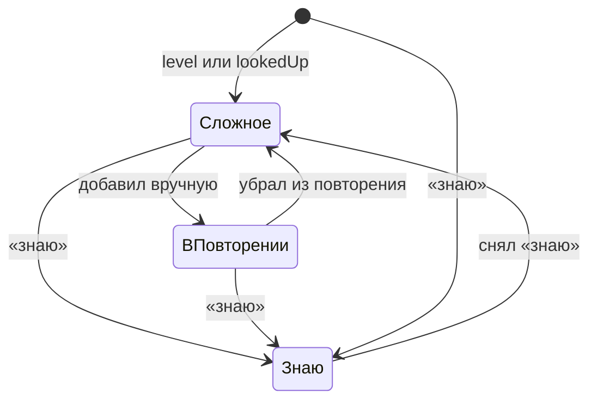

# Архитектура приложения

Стек: Flutter (MacOs, Android P0, iOS P2). Общая схема «приложение + сервер» — в [Architecture.md](Architecture.md), требования — в [Requirements.md](Requirements.md).

## 1. Главная идея

Приложение собирается из независимых модулей вокруг ядра `core`. Ядро — чистый Dart: доменная модель, интерфейсы (порты) и сценарии. Всё, что можно заменить, — открывашки файлов, рендерер, провайдеры перевода, алгоритм повторений, хранилище — живёт в отдельных пакетах-адаптерах и подключается в одной точке сборки.

Правила:

1. **`core` ни от чего не зависит.** Ни Flutter, ни SQLite, ни HTTP. Только Dart SDK и мелкие чистые утилиты.
2. **Адаптеры зависят только от `core`** (и своих сторонних библиотек). Адаптеры не знают друг о друге.
3. **UI зависит от `core` и от API рендерера**, но не от конкретных адаптеров.
4. **Конкретные реализации выбирает только `app`** — в composition root (`bootstrap.dart`).
5. **Данные, которые переживают замену модуля, хранятся в нейтральном формате.** Позиция в книге не завязана на рендерер, состояние карточки — на алгоритм.

```
                         ┌──────────────┐
                         │     app      │  composition root, роутинг
                         └──────┬───────┘
          ┌──────────────┬──────┴───────┬──────────────────┐
          ▼              ▼              ▼                  ▼
   ┌────────────┐ ┌─────────────┐ ┌────────────┐   ┌──────────────┐
   │ features/* │ │ reader_*    │ │ adapters:  │   │ adapters:    │
   │ (UI)       │ │ (рендереры) │ │ formats,   │   │ storage,     │
   │            │ │             │ │ lookup,srs │   │ secrets, ... │
   └─────┬──────┘ └──────┬──────┘ └─────┬──────┘   └──────┬───────┘
         │               ▼              │                 │
         │        ┌─────────────┐       │                 │
         ├───────▶│ reader_api  │       │                 │
         │        └──────┬──────┘       │                 │
         ▼               ▼              ▼                 ▼
   ┌──────────────────────────────────────────────────────────────┐
   │ core: доменная модель · порты · сценарии (чистый Dart)       │
   └──────────────────────────────────────────────────────────────┘
```

## 2. Структура `app/`

Монорепозиторий на [pub workspaces](https://dart.dev/tools/pub/workspaces); при необходимости сверху melos для скриптов.

```
app/
  app/                     main.dart, bootstrap.dart, роутинг, тема
  packages/
    core/                  чистый Dart: domain, ports, application (сценарии)
    core_testing/          фейки портов и контрактные тесты для адаптеров

    reader_api/            Flutter: контракт рендерера (ReaderEngine, события)
    reader_simple/         MVP-рендерер на виджетах Flutter

    format_epub/           открывашка EPUB → ContentDocument
    format_txt/            TXT (P1)
    format_fb2/            FB2 (P1)

    lookup_wiktionary/     провайдер: офлайн-пакет en-en из Wiktionary
    lookup_stardict/       провайдер: импортированные словари StarDict
    lookup_llm/            провайдер: LLM (OpenAI-совместимый API), после MVP
    lookup_translate_api/  провайдер: API переводчика, после MVP

    srs_sm2/               планировщик SM-2 (простой, первый после MVP)
    srs_fsrs/              планировщик FSRS

    storage_drift/         SQLite через drift: все репозитории
    packs_http/            скачивание пакетов данных с сервиса
    secrets_platform/      ключи API в Keystore/Keychain, после MVP
    text_en/               токенизация, предложения, леммы для английского
    levels_cefr/           уровни слов из пакета en-levels

    features/
      library/  reader/  lookup_sheet/  history/  review/  quiz/  cheatsheet/  settings/
```

Каждый пакет — отдельный `pubspec.yaml`. Это физически не даёт `core` импортировать Flutter, а фиче — конкретный адаптер. Дополнительно в CI: `custom_lint`/`import_lint` с правилами из раздела 1.

## 3. Доменная модель (`core/domain`)

Все сущности — неизменяемые классы (`freezed` или ручные `==`/`copyWith`). Идентификаторы — типизированные обёртки (`BookId`, `TermId`…), а не голые строки.

### 3.1. Книги и чтение

| Сущность | Что это |
|---|---|
| `Book` | Книга в библиотеке: `id`, метаданные (название, автор, язык), `format`, путь к файлу, хеш содержимого, дата добавления |
| `BookFormat` | `epub`, `fb2`, `txt`, `pdf` |
| `TocEntry` | Пункт оглавления: заголовок, `ChapterRef`, вложенные пункты |
| `ChapterRef` | Нейтральная ссылка на главу: `href` внутри книги + порядковый индекс |
| `Locator` | Позиция в книге (см. ниже) |
| `ReadingProgress` | Последний `Locator` книги, общий процент, время |
| `ContentDocument` | Промежуточное представление главы: блоки (абзац, заголовок, цитата, список, картинка) и инлайны (текст, курсив, ссылка) |

**`Locator` не зависит от рендерера.** Он устроен по образцу W3C Web Annotation / Readium:

```dart
class Locator {
  final BookId book;
  final ChapterRef chapter;
  final double progression;     // 0..1 внутри главы
  final TextQuote? quote;       // точная цитата + 30 символов до и после
  final String? engineHint;     // кэш быстрой позиции конкретного движка, необязателен
}
```

Если сменим рендерер, `engineHint` станет бесполезным, но позиция восстановится по `chapter` + `quote`, а в худшем случае — по `progression`. Так же хранятся места запросов в истории (H-2, H-3).

### 3.2. Перевод и история

| Сущность | Что это |
|---|---|
| `LookupMode` | `enRu` (перевод) или `enEn` (толкование) |
| `LookupQuery` | Что спросили: текст выделения, контекстное предложение, `Locator`, режим |
| `LookupResult` | Ответ провайдера: список `Sense` (перевод/толкование, часть речи, примеры), транскрипция, `ProviderId` |
| `ProviderId` | Строковый идентификатор провайдера (`llm.openai`, `stardict.freedict-eng-rus`) |
| `LookupEvent` | **Журнал**: один факт запроса — `LookupQuery` + `LookupResult` + время. Пишется всегда (H-1, H-2) |
| `Term` | Агрегат слова/фразы: нормализованная форма (лемма), язык, счётчик запросов, ссылки на события (H-4) |
| `CefrLevel` | `a1`…`c2`, `unknown` |
| `TermStatus` | `learning`, `known`, `ignored` (T-5, U-3) |

`LookupEvent` — источник правды. `Term` можно пересобрать из журнала, поэтому изменение правил нормализации (например, лемматизации) не теряет данные.

**Жизненный цикл слова** ([B-029](backlog/B-029-term-lifecycle.md)). Состояния:

- **сложное** — выше уровня пользователя и проходит порог частотности (источник `level`) или его переводили и не пометили «знаю» (источник `lookedUp`, без фильтра уровня и частотности). Источник — атрибут. Сложные слова куска идут в шпаргалку одним списком по частотности, сложные слова главы подсвечиваются (T-121);
- **в повторении** — пользователь сам добавил слово в колоду (B-013); атрибуты состояния — позже;
- **знаю** — `TermStatus.known`, из любого состояния; такое слово не показывается нигде, кроме истории.



Фразы в этот цикл пока не входят.

### 3.3. Повторение

| Сущность | Что это |
|---|---|
| `Card` | Карточка: `TermId`, лицевая и обратная сторона, выбранный контекст (`LookupEventId`) |
| `Rating` | Оценка ответа: `again`, `hard`, `good`, `easy` |
| `ReviewLog` | Факт повторения: карточка, оценка, время, длительность, источник (`review`/`quiz`) |
| `SchedulingState` | Состояние карточки у алгоритма: `algorithmId`, `version`, `due`, `payload` (непрозрачный JSON) |
| `Quiz`, `QuizItem` | Тест по главе: задания и их тип (выбор перевода, обратный перевод, пропуск в предложении) |

`ReviewLog` — источник правды, `SchedulingState` — кэш. При смене алгоритма (SM-2 → FSRS) состояние пересчитывается повтором `ReviewLog` через новый планировщик.

### 3.4. Профиль и шпаргалка

| Сущность | Что это |
|---|---|
| `UserProfile` | Режим по умолчанию (`LookupMode`), уровень (`CefrLevel`), размер куска для шпаргалки (`CheatSheetScope`), порядок провайдеров, настройки отображения |
| `CheatSheetScope` | Какой кусок текста разбирает шпаргалка: `pages(n)` — n условных страниц по 300 слов (по умолчанию 10) или `chapter` — до конца текущей главы |
| `CheatSheet` | Шпаргалка к фрагменту: диапазон (`Locator` от/до), список `CheatSheetItem` (слово или выражение, тип, уровень, перевод, пример из текста) |

## 4. Порты (`core/ports`)

Интерфейсы, которые реализуют адаптеры. Ядро вызывает только их.

```dart
/// Открывашка формата (R-1).
abstract interface class BookFormatAdapter {
  Set<BookFormat> get formats;
  Future<bool> canOpen(FileRef file);
  Future<BookMetadata> readMetadata(FileRef file);
  Future<OpenedBook> open(FileRef file);
}

abstract interface class OpenedBook {
  List<TocEntry> get toc;
  List<ChapterRef> get spine;
  Future<ContentDocument> chapter(ChapterRef ref);
  Future<Uint8List> resource(String href);   // картинки, шрифты
  Future<void> close();
}

/// Провайдер перевода или толкования (P-1).
abstract interface class LookupProvider {
  ProviderId get id;
  ProviderInfo get info;               // имя, онлайн/офлайн, поддерживаемые режимы
  bool supports(LookupMode mode);
  Future<LookupResult> lookup(LookupQuery query, {CancelToken? cancel});
}

/// Алгоритм интервальных повторений (L-2).
abstract interface class SrsScheduler {
  String get algorithmId;
  SchedulingState initial(DateTime now);
  SchedulingState next(SchedulingState state, Rating rating, DateTime now);
}
```

Остальные порты:

| Порт | Назначение | MVP-реализация |
|---|---|---|
| `BookRepository`, `ProgressRepository` | Библиотека и позиции | `storage_drift` |
| `LookupJournal` | Запись и выборки `LookupEvent` с фильтрами (H-5) | `storage_drift` |
| `TermRepository`, `CardRepository`, `ReviewLogRepository` | Слова, карточки, повторения | `storage_drift` |
| `ProfileRepository` | Профиль и настройки | `storage_drift` |
| `PackStore` | Список пакетов данных, скачивание, версии, проверка sha256 | `packs_http` |
| `SecretStore` | Ключи API | после MVP, `secrets_platform` |
| `TextAnalyzer` | Предложения, токены, леммы | `text_en` |
| `LevelDictionary` | Уровень CEFR слова | `levels_cefr` |
| `CheatSheetGenerator` | Поиск сложных слов и выражений во фрагменте | Локальный: слова по уровню. Выражения — после MVP, разметка с сервиса, см. [Data-sources.md](Data-sources.md) |
| `Exporter` | CSV, Anki (H-6) | P2 |
| `Clock`, `IdGenerator` | Время и id — для детерминированных тестов | системные |

Все методы репозиториев асинхронные и возвращают доменные типы, а не строки таблиц. Чтение списков — через `Stream`, чтобы UI обновлялся сам.

## 5. Сценарии (`core/application`)

Сценарий — класс с одним публичным методом. Он получает порты через конструктор и не знает про UI.

| Сценарий | Что делает | Требования |
|---|---|---|
| `ImportBook` | Подбирает адаптер по формату, читает метаданные, копирует файл, сохраняет `Book` | R-1, R-4 |
| `OpenBook` | Открывает книгу, возвращает `OpenedBook` и последнюю позицию | R-2 |
| `SaveProgress` | Сохраняет `Locator` (с дебаунсом на стороне UI) | R-2 |
| `LookupSelection` | Строит `LookupQuery`, идёт по цепочке провайдеров, пишет `LookupEvent`, обновляет `Term` | T-1, P-4, H-1, H-2, H-4 |
| `SetTermStatus` | «Знаю», «учу», «игнорировать» | T-5, U-3 |
| `CreateCard` | Карточка из `Term` и выбранного контекста | L-1 |
| `GetDueCards`, `ReviewCard` | Очередь повторения; оценка → `ReviewLog` → новый `SchedulingState` | L-2 |
| `BuildChapterQuiz`, `SubmitQuiz` | Тест по словам главы; результаты пишутся в `ReviewLog` | L-3…L-5 |
| `BuildCheatSheet` | Текущий `Locator` + `CheatSheetScope` → диапазон текста (может идти через несколько глав) → `TextAnalyzer` + `LevelDictionary` + `CheatSheetGenerator` → фильтр по уровню и статусу | S-1…S-6 |
| `RebuildSchedule` | Пересчёт `SchedulingState` при смене алгоритма | — |

### Цепочка провайдеров

`LookupSelection` использует `ProviderChain` из ядра: берёт порядок из `UserProfile`, отбрасывает провайдеры без поддержки режима, вызывает по очереди с таймаутом. Первый успешный ответ возвращается в модалку; ошибка или таймаут — переход к следующему (P-4). Смена провайдера в модалке (T-5) — тот же вызов с явным `ProviderId`. Каждый ответ — отдельный `LookupEvent`.

### Поток запроса перевода

```
reader_simple ──ReaderEvent.selection(text, Locator, sentence)──▶ features/reader
features/reader ──открывает──▶ features/lookup_sheet (модалка сразу, со скелетоном)
lookup_sheet ──▶ LookupSelection
                   ├─ TextAnalyzer: нормализация, лемма
                   ├─ ProviderChain ─▶ LookupProvider #1 ─(ошибка)─▶ #2 …
                   ├─ LevelDictionary: уровень
                   ├─ LookupJournal.append(LookupEvent)
                   └─ TermRepository.upsert(Term)
lookup_sheet ◀── LookupResult + CefrLevel + TermStatus
```

## 6. Рендерер (`reader_api`)

Рендерер — единственная крупная часть, которая обязана зависеть от Flutter. Поэтому контракт вынесен в отдельный пакет `reader_api`, а не в `core`.

```dart
abstract interface class ReaderEngine {
  Widget buildView(BuildContext context);
  Future<void> load(OpenedBook book, {required BookId bookId, Locator? at});
  Future<void> goTo(Locator locator);
  void applySettings(ReaderSettings settings);   // шрифт, размер, тема, отступы (R-3)
  void highlight(List<Locator> ranges);          // подсветка запрошенных слов
  Stream<ReaderEvent> get events;
  Future<void> dispose();
}

sealed class ReaderEvent {}
class PositionChanged extends ReaderEvent { final Locator locator; }
class TextSelected   extends ReaderEvent { final String text; final Locator at; final String sentence; }
class WordTapped     extends ReaderEvent { final String word; final Locator at; final String sentence; }   // T-2
class ChapterFinished extends ReaderEvent { final ChapterRef chapter; }                                    // L-3
```

Фича `reader` знает только `ReaderEngine`. Конкретный движок создаёт фабрика из `app`.

**MVP: `reader_simple`.** Рисует `ContentDocument` виджетами Flutter: глава — прокручиваемый список блоков, абзац — `SelectableText.rich`. Внутренняя позиция — индекс блока + смещение символа; наружу отдаётся `Locator` с `TextQuote`.

**Возможные замены** без изменений в `core` и фичах:
- свой постраничный рендерер на `TextPainter`;
- WebView + epub.js/foliate-js — получает `OpenedBook.resource()` и сырые XHTML-главы, отдаёт события через JS-мост;
- нативный Readium через platform channel.

Если новый движок работает с исходными файлами, а не с `ContentDocument`, `OpenedBook` даёт и то и другое: `chapter()` для нашего рендерера и `resource()` для движков, которым нужен оригинал.

## 7. Хранилище

`storage_drift` реализует все репозитории поверх одной SQLite-базы. Таблицы и DAO — внутренняя деталь пакета; наружу выходят только доменные типы, маппинг — в самом пакете.

Основные таблицы: `books`, `reading_progress`, `lookup_events`, `terms`, `term_events` (связь), `cards`, `review_logs`, `scheduling_states`, `profile`, `provider_settings`.

- `Locator` и `SchedulingState.payload` хранятся как JSON-колонки.
- Миграции — средствами drift, со схемными тестами.
- Файлы книг — в каталоге приложения, имя — хеш содержимого.
- Офлайн-словари (P-3) — отдельные файлы в каталоге приложения, ими управляет `lookup_stardict`.
- Ключи API — только в `SecretStore`, в базе лишь ссылка на ключ.

Смена хранилища (например, на Isar или с синхронизацией) — новый пакет, реализующий те же порты, плюс разовый перенос данных.

## 8. UI и состояние

- Управление состоянием — Riverpod. Провайдеры Riverpod живут в `features/*` и `app`, в `core` их нет.
- Фича получает сценарии и порты через провайдеры Riverpod, которые в `app/bootstrap.dart` переопределяются конкретными реализациями (`ProviderScope(overrides: [...])`).
- Навигация — `go_router` в `app`.
- Фичи не импортируют друг друга. Переход из истории к месту в книге (H-3) — маршрут с `Locator` в параметрах.

```dart
// app/lib/bootstrap.dart (сокращённо)
final overrides = [
  bookFormatsProvider.overrideWithValue([EpubFormatAdapter()]),
  readerEngineFactoryProvider.overrideWithValue(() => SimpleReaderEngine()),
  lookupProvidersProvider.overrideWithValue([
    LlmLookupProvider(secrets: secrets, http: http),
    TranslateApiProvider(secrets: secrets, http: http),
  ]),
  srsSchedulerProvider.overrideWithValue(Sm2Scheduler()),
  ...driftRepositoryOverrides(db),
];
```

Замена модуля — правка этого файла и `pubspec.yaml` приложения. Можно держать две реализации одновременно и выбирать флагом в настройках разработчика — удобно для сравнения рендереров.

## 9. Тестирование

| Уровень | Что проверяем | Чем |
|---|---|---|
| `core` | Доменные правила и сценарии | `package:test`, фейки из `core_testing`, без Flutter |
| Контрактные тесты | Что каждая реализация порта ведёт себя одинаково | Общие наборы в `core_testing`: `lookupProviderContract()`, `srsSchedulerContract()`, `formatAdapterContract()`, `repositoryContract()`. Каждый адаптер запускает их у себя |
| Адаптеры | Разбор реальных файлов, маппинг БД, HTTP | Фикстуры книг, in-memory SQLite, мок HTTP |
| Фичи | Виджеты и состояние | `flutter_test` с фейковыми портами |
| Сквозные | Открыть книгу → выделить → перевод → карточка | `integration_test` на macOS (`-d macos`), позже на Android |

Контрактные тесты — главная защита заменяемости: новый рендерер, провайдер или алгоритм считается готовым, когда проходит тот же набор.

## 10. MVP (P0)

Вехи и критерии готовности — в [MVP-plan.md](MVP-plan.md).

| Модуль | Реализация в MVP |
|---|---|
| Форматы | `format_epub` |
| Рендерер | `reader_simple`: прокрутка, тап и выделение, оглавление, позиция |
| Данные | `packs_http`: пакеты `en-en`, `en-forms`, `en-levels` с мини-сервиса в домашней сети |
| Провайдеры | `lookup_wiktionary` (EN→EN), `lookup_stardict` (EN→RU); цепочка с фолбэком |
| История | `LookupEvent` + `Term` в `storage_drift`, переход к месту в книге |
| Уровни | `levels_cefr` |
| Шпаргалка | Локальный `CheatSheetGenerator`: слова следующего куска текста (10 страниц или до конца главы) выше уровня пользователя, без уже запрошенных |
| Профиль | Режим `enEn`/`enRu` (по умолчанию `enEn`), уровень (по умолчанию B2), размер куска для шпаргалки, порядок провайдеров, адрес сервиса |

Не входит: FB2/TXT/PDF, онлайн-провайдеры и ключи API, карточки и повторение, тесты по главе, выражения в шпаргалке, экспорт. Под каждое из этого порт уже есть, поэтому добавление — новый пакет и строка в `bootstrap.dart`.

## 11. Решения, которые стоит зафиксировать в ADR

1. Pub workspaces или melos — пока достаточно workspaces.
2. `freezed` для доменных классов или ручной код — `freezed` удобнее, но тянет кодогенерацию в `core`.
3. Формат `TextQuote`: длина префикса/суффикса, нормализация пробелов.
4. Где хранить промпты LLM-провайдера и как версионировать их, чтобы журнал помнил, каким промптом получен ответ.
5. Нужна ли постраничная вёрстка в MVP или достаточно прокрутки.
