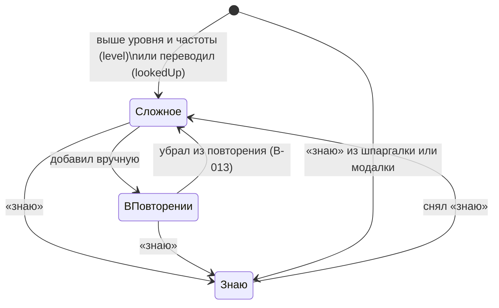

# B-029. Жизненный цикл слов и фраз

**Статус:** решения приняты (см. «Решения»); п. 1–7 и 10 (атрибут источника) — в [T-121](../tasks/T-121.md); фразы — открытая тема  
**Тип:** исследование и документация  
**Связано с:** [B-011](B-011-cheatsheet-controls.md), [B-013](B-013-spaced-repetition.md), [B-019](B-019-text-highlights.md), [B-009](B-009-deepl-phrases.md), `core` (`Term`, `TermStatus`)

## Проблема

Нигде не описано, что происходит со словом от первого перевода до «знаю», и что должно происходить. В частности, непонятно, что со словами, которые переводил, но «знаю» не нажал.

## Как сейчас (по `DECISIONS.md`, 2026-11-28)

Перевод слова (на экране ≥ 2 с) пишет событие в журнал и создаёт или обновляет `Term` со статусом `learning`. Дальше такое слово:

- **в истории** — видно, со счётчиком переводов и контекстами;
- **в шпаргалке** — не появляется: шпаргалка прячет любой термин из истории, не только `known`;
- **подсветка «сложные слова»** — подсвечивается, если подходит по уровню и частотности (прячутся только `known`);
- **подсветка «переведённые»** — подсвечивается, если переводил после последней шпаргалки этой книги; новая шпаргалка этот набор обнуляет;
- **в повторение** не попадает: повторения пока нет, а по B-013 туда попадает только то, что добавил сам.

`known` прячется везде: в шпаргалке, во всех подсветках. Снять пометку можно в истории и в модалке. Фразы живут отдельно, «знаю» у них нет.

Получается, что слово, которое переводил и забыл, больше не попадёт в шпаргалку, а в тексте подсветится, только если оно «сложное» или переведено недавно.

## Наблюдение

Подсветка новых сложных слов в тексте сама работает как интервальное повторение: встретил слово снова, оно подсвечено, вспомнил или переспросил. Это стоит учитывать при выборе: возможно, часть задач повторения решает чтение, а не отдельный экран.

## Что решить

1. Состояния слова и переходы между ними: новое → переводил → в повторении → знаю (или другой набор). Что их меняет: перевод, «знаю», повторение, число переводов, время.
2. Должно ли переведённое слово возвращаться в шпаргалку (например, если переводил давно или много раз).
3. Как подсвечивать переведённые слова дальше, чем до следующей шпаргалки.
4. Связь с B-013: добавлять ли в повторение автоматически после N переводов, или только вручную.
5. То же для фраз.

## Решения (2026-11-28)

1. **Два источника сложных слов.** Слово считается новым сложным, если:
   - (а) оно выше уровня пользователя и проходит порог частотности (как сейчас);
   - (б) или его переводили (перевод был на экране ≥ 2 с, то есть есть в журнале) и не пометили «знаю».
2. Переведённое слово **остаётся в шпаргалке**: шпаргалка прячет только `known`, а не любой термин из истории. Это отменяет правило T-053 «шпаргалка прячет любой термин истории».
3. Слова из источника (б) попадают в шпаргалку и в подсветку «сложные слова», только если встречаются в куске (или в главе для подсветки).
4. Слова из источника (б) попадают туда **всегда**, без фильтра уровня и частотности: иначе переведённое лёгкое слово снова пропадёт.
5. **Сортировка и лимит.** Слова из (а) и (б) идут одним списком, отсортированным по частотности (от частых к редким, слова без `zipf` в конце), и лимит 20 / 50 берёт верх этого списка. Отдельной квоты у (б) нет.
6. **Метка «переводил».** У слова из (б) в шпаргалке — значок и счётчик переводов (`×N`).
7. **Подсветка после следующей шпаргалки** (вопрос 3) отдельного решения не требует. Подсветка «переведённые» по-прежнему держится до следующей шпаргалки. Дальше переведённое слово подсвечивается как «слово шпаргалки», если попало в показанный список, а иначе как «сложное» (решения 1, 4).
8. **Повторение** (вопрос 4): в колоду B-013 слова пока добавляются только вручную. К автодобавлению вернуться после того, как появится повторение.
9. **Фразы** (вопрос 5): пока ничего из этого к фразам не применяем, тема открыта.
10. **Состояния слова** (вопрос 1):
    - **сложное** — слово попало в сложные по уровню и частотности или потому, что его переводили. У состояния есть атрибут «откуда»: `level`, `lookedUp` или оба;
    - **в повторении** — пользователь сам добавил слово в повторение;
    - **знаю** — пользователь пометил «знаю». Перейти сюда можно из любого состояния.

    Атрибуты состояния «в повторении» (стадия, расписание) добавим позже, вместе с B-013.

Открыто: куда возвращается слово, с которого сняли «знаю», если оно было в повторении: в повторение или в сложные. Предлагаю в сложные. Как это ляжет на `TermStatus` (`learning`, `known`, `ignored`) и считать ли `level` в базе или на лету, как сейчас, — решить в задаче.

## Результат

Раздел или отдельный документ с диаграммой состояний (в `docs/`), затем задачи на изменения.
